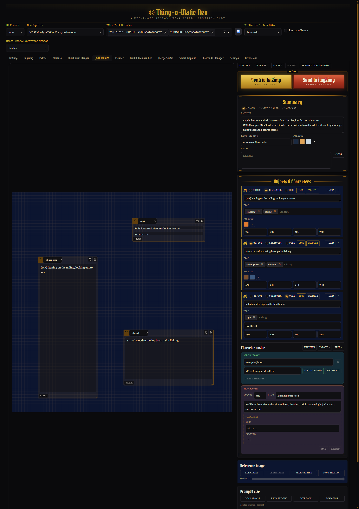
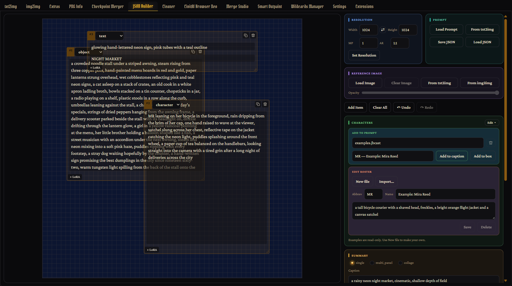
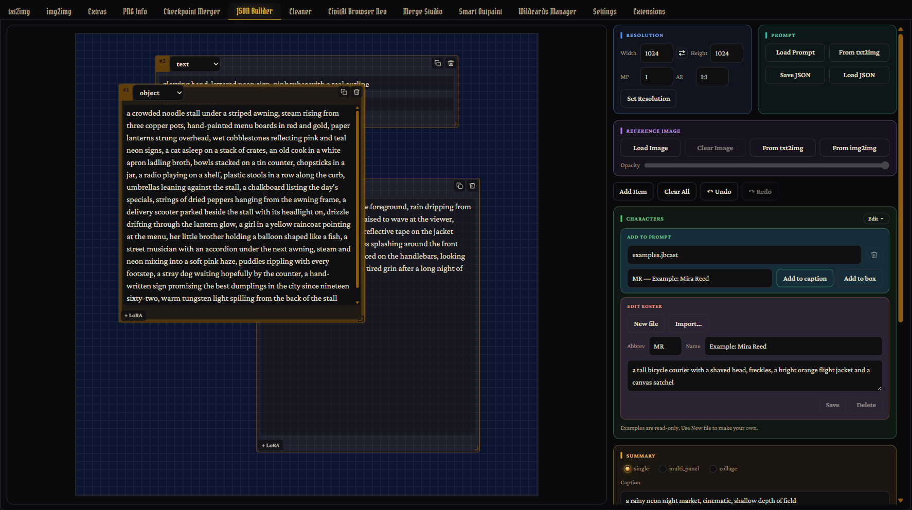

# Changelog

Changes in this fork (Forge Neo — Silk Custom), newest first. Upstream changes from
[Haoming02/sd-webui-forge-classic](https://github.com/Haoming02/sd-webui-forge-classic) are
listed only as merges; see that repo for their details.

## 2026-11-15

### JSON Builder is now its own extension: MOSS Layout

Everything below now lives in **[sd-forge-moss-layout](https://github.com/SillySilk/sd-forge-moss-layout)**, which any
Forge Neo can install from **Extensions → Install from URL**. It opens in its own **MOSS Layout** tab.
The built-in JSON Builder here is back to upstream's plain version and is switched off.
Your last autosaved layout does not carry over once (**Restore last session** starts empty).

### JSON Builder: new side panel, tags and palettes

- **New order, top to bottom:** the toolbar, then large **Send to txt2img** (gold) and **Send to img2img** (red)
  buttons, then **Summary**, then **Objects & Characters** (the box list with the character roster inside it),
  then **Reference image**, then **Prompt & size** at the bottom.
- **Thing-o-Matic look** for the panel: blackletter section titles, typewriter labels, gold corner brackets.
- **Tags and Palette on every box.** MOSS-Image reads a short keyword list and a colour list for each box.
  In a same-seed test on MOSS, **tags changed the picture strongly** (a red umbrella, a top hat, a sleeping cat on
  the bench, each in its own box), while **palette had only a weak effect**.
- **Palette for the whole image**, beside **Meta**. Meta sets the medium: `watercolor illustration` alone turned a
  photo into a painting.
- **Characters can carry tags and a palette** (the **Advanced** fold in Edit roster). **Add to box** copies them
  into the selected box, without repeats.
- **Size follows txt2img, and now says so.** Next to the width and height it reads *following txt2img* or
  *pinned* (after you set a size by hand); **Follow txt2img** takes txt2img's size again.
  The Resolution section is folded into **Prompt & size**.

### JSON Builder: the box you click covers the ones behind it

Clicking a box on the canvas (or typing in it) brings it to the front and makes it almost solid,
so text from overlapping boxes no longer shows through. When its text is longer than the box,
a scroll bar appears inside it and the mouse wheel scrolls the text.

| Before: overlapping boxes show through | After: the selected box covers them |
|---|---|
|  |  |

### JSON Builder: opens blank, buttons on top
- The builder now **opens with a blank canvas**. Your last layout is still kept; **Restore last session** brings it back (and Undo takes it away again).
- **Add Item, Clear All, Undo, Redo** and **Restore last session** sit at the very top of the side panel.
- **Send to txt2img / Send to img2img** sit right under that toolbar.
- The Characters section is now **Character roster**, with **New file** and **Import…** in its title row.
- A small **+ Add character** button under the character dropdown opens the editor and clears the fields for a new character; Save adds it.
- The **character list** starts on "Choose character list" instead of reopening the last one.
- **Resolution** folds away at the bottom behind a small button showing the current size, since the size mostly follows txt2img.

### JSON Builder: more editing conveniences
- **Undo / Redo** buttons, plus Ctrl+Z and Ctrl+Y (or Ctrl+Shift+Z). Typing in one field or a run of nudges counts as one step.
- **Keyboard:** click a box to select it, then Delete removes it, arrows move it (Shift for bigger steps), Ctrl+D duplicates it and Esc deselects.
- **Resize from any side or corner;** hold Shift to keep the shape. A ⇄ button swaps width and height.
- **Snapping:** dragged or resized boxes snap to the canvas and to other boxes, with pink guide lines. Hold Alt to move freely.
- **Autosave:** the layout is kept in the browser.
- **From txt2img** (Prompt section) loads txt2img's current prompt and size into the builder.
- Boxes and list rows show their number (`#1`, `#2` …), the order the prompt uses.
- **Add to box** (Characters) puts a character's abbreviation at the start of the selected box's caption.
- Each section has its own colour tint, and Characters is split into **Add to prompt** and **Edit roster**.

### JSON Builder: Characters
- Save characters as an **abbreviation** (1–5 letters or digits), a **full name** and a **description** in `.jbcast` files.
- **Add to caption** puts the full description into the Summary caption once; after that the boxes only need the abbreviation (for example `MR waving`).
- A trash button removes a character file (it is moved to `characters/deleted/`, not erased) after a confirmation.
- Only `examples.jbcast` ships with the repo. Your own `.jbcast` files stay on your PC and are never committed.

### LoRA
- **The LoRA folder follows the UI Preset.** Pick `moss` and the LoRA tab shows the `Moss` folder; `krea` shows `krea2`, and so on (Anima, Klein, Qwen2.1 too). A preset without a folder of its own shows all of them. You can still pick a folder by hand; it holds until the next preset change.
- **JSON Builder + LoRA buttons** now list every LoRA in the active folder, whatever subfolder or search the txt2img LoRA tab was left on.
- Each canvas box has its own **+ LoRA** button.

### Fixes
- Loaded prompts keep their brackets exactly as typed.
- Odd sizes or boxes can no longer break **Send to txt2img**: sizes snap to multiples of 16 and box numbers stay inside the canvas.
- ControlNet: the unit badge and active-unit highlight work again.
- Upstream merge: 17 commits, version **2.32** (new GGUF reader, rewritten Extensions tab).

## 2026-11-08
- Inpaint canvas: shapes are always filled with the one brush colour (the outline option is gone), and the inpaint mask always paints in grey.

## 2026-11-01 – 2026-11-06
- JSON Builder: a **trash** and a **duplicate** button on each box; **From txt2img / From img2img** grab a reference image.
- MOSS: the edit method offers only Disable / ai-toolkit (Moss-Image-Edit missed parts of edits in testing).
- Attention: flash attention is skipped quietly for fp32 inputs.
- Upstream merges: 2.31-28 to 2.31-40.

## 2026-10-25 – 2026-10-31
- JSON Builder:
  - follows txt2img's resolution until you change the size;
  - has a **+ LoRA** picker for Extra and for each item;
  - can load a **reference image** to trace boxes over;
  - lets you change a box's type from its tag;
  - puts **Add Item** above Summary.
- **MOSS regional LoRA:** a LoRA tag inside a JSON Builder item's caption acts only inside that item's box.
- MOSS: prompts of different lengths in one batch each get their real length.
- Server: GZip compression is applied again.
- Upstream merges: 2.31-8 to 2.31-22.

## 2026-10-18 – 2026-10-23
- The **Checkpoint** dropdown lists only the selected preset's models, detected from inside each file.
- Presets always load their VAE and text encoder, and retry with the matching preset's files on a mismatch.
- Qwen-Image-2.1 replaces the old Qwen-Image presets, with its official **Qwen 2.1 Turbo** schedule. Retired presets are hidden.
- The launcher closes a running Forge instead of starting a second one, and only one Forge browser tab stays open.
- Upstream merges: 2.30-11 to 2.31-8 (MOSS-Image support arrives upstream).
